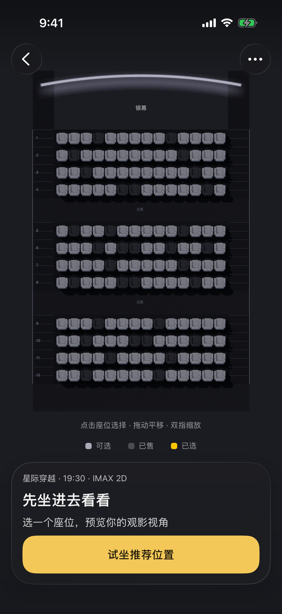
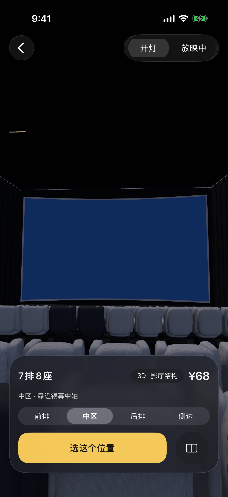

# CINÉ · 沉浸式影院选座

一个可以直接运行的 iOS 交互 Demo：从正俯视座位图进入真实的三维影厅，在座位视角中比较前排、中区、后排和侧边，再完成本地选座与预留流程。

使用 **SwiftUI + RealityKit + Observation + AVFoundation**，最低 **iOS 26**，没有第三方包依赖或 API Key。

<p>
  
  
</p>

以上为公开版实际运行截图。公开仓库不附带电影预告或电影参考图片，银幕使用代码内置的静态回退；可自行接入有权使用的本地视频。

## 运行

1. 使用 Xcode 26 或更新版本打开 [iOSDemo/CinemaDemo.xcodeproj](iOSDemo/CinemaDemo.xcodeproj)。
2. 选择 **CinemaDemo** scheme 和 iOS 26+ iPhone 模拟器。
3. 按 **⌘R**。

也可以在仓库根目录运行：

```sh
cd iOSDemo
./scripts/run-simulator.sh
```

真机运行时，在 Signing & Capabilities 中选择自己的开发团队。Xcode 27 使用 Device Hub 显示模拟器，选择设备后点 **View Screen**。

## 主要交互

- **正交俯视选座**：座位保持水平平行，支持点击、拖动平移和双指缩放。
- **真实三维试坐**：同一份座椅、银幕与库存状态，通过移动相机切换视角。
- **阶梯影厅**：12 排 × 14 座；第 4/5、8/9 排之间有横向过道；每排升高 0.30 米。
- **结构视图**：从斜侧面观察前低后高的平台和侧边梯道。
- **空间与材质**：程序化织物 PBR 贴图、缝边、共享网格与分层灯光。
- **原生 Liquid Glass**：系统按钮、分段控件、菜单、弹层和磨砂玻璃卡片。
- **平滑卡片高度变化**：底边固定，约 0.42 秒的轻弹簧动画。
- **本地业务演示**：双座选择、A/B 比较、确认、预留、成功与冲突恢复。

库存、票价、倒计时和预留均为本地样例，不会创建真实订单或发起支付。

## 源码与设计文件

| 目录 | 内容 |
| --- | --- |
| [iOSDemo/CinemaDemo/Models](iOSDemo/CinemaDemo/Models) | 排座、阶梯、视线几何和选座状态 |
| [iOSDemo/CinemaDemo/Scene](iOSDemo/CinemaDemo/Scene) | RealityKit 几何、材质、灯光、命中与相机 |
| [iOSDemo/CinemaDemo/Views](iOSDemo/CinemaDemo/Views) | SwiftUI 页面与 Liquid Glass 控件 |
| [iOSDemo/CinemaDemoTests](iOSDemo/CinemaDemoTests) | 选座、计价、预留和几何测试 |
| [iOSDemo/CinemaDemoUITests](iOSDemo/CinemaDemoUITests) | 实景切换、手势、比较及预留 UI 测试 |
| [design/latest](design/latest) | 最新两屏 Figma UI 图层 SVG、暗色规范、设计 tokens、阶梯排座数据 |
| [design/archive/light-concept](design/archive/light-concept) | 早期浅色方案的可编辑 SVG 与生成脚本，保留设计过程 |
| [docs/images](docs/images) | 不含电影素材的公开版运行截图 |

SVG 可下载后导入 Figma、Illustrator 或其他矢量工具。最新 SVG 保留文字和矢量 UI；为公开分发移除了三维场景的栅格填充，真实 3D 场景由源码运行生成。这些文件不是 `.fig` 文件，历史浅色 SVG 也不代表当前界面。

原 Figma 设计：[俯视页](https://www.figma.com/design/2Lpz6SXUPbAjcHAytHZhBd?node-id=7-184) · [座位实景页](https://www.figma.com/design/2Lpz6SXUPbAjcHAytHZhBd?node-id=70-884)。在线文件仍按原分享权限访问，仓库内的 SVG 和 JSON 可以直接公开下载。

## 接入自己的银幕视频

将有权使用的视频命名为 `cinema-trailer.mp4`，放到 `iOSDemo/CinemaDemo/Media/` 后重新构建。也支持同名 `.mov` / `.m4v`。

`CinemaScreenPlayback` 使用 AVQueuePlayer、AVPlayerLooper 和 RealityKit VideoMaterial。默认静音循环，按原始宽高比适配；离开试坐、进入结构模式、打开弹层或 App 失活时暂停。缺片或解码失败时保留静态银幕。电影素材默认被 Git 忽略，运行时无需网络。

## 验证

公开副本的构建与测试记录见 [docs/validation.md](docs/validation.md)。模型和 UI 测试命令：

```sh
cd iOSDemo
xcrun simctl list devices available
xcodebuild -project CinemaDemo.xcodeproj -scheme CinemaDemo \
  -destination 'platform=iOS Simulator,id=SIMULATOR_ID' \
  -derivedDataPath .build CODE_SIGNING_ALLOWED=NO test
```

`SIMULATOR_ID` 替换为实际设备 ID。设备上的帧率、发热和其他屏幕尺寸需要单独验证。

## 素材与署名

本仓库不分发原演示中的《星际穿越》预告片、电影图片、参考视频、系统字体文件或 Apple UI 组件库。设计精修过程中参考了 [unslop by Damir Sokolovsky](https://github.com/heydamir/unslop)，相关方法来源为 CC BY 4.0；见 [CREDITS.md](CREDITS.md)。

本仓库目前用于公开展示与学习，尚未另行指定源码的开源许可证。
