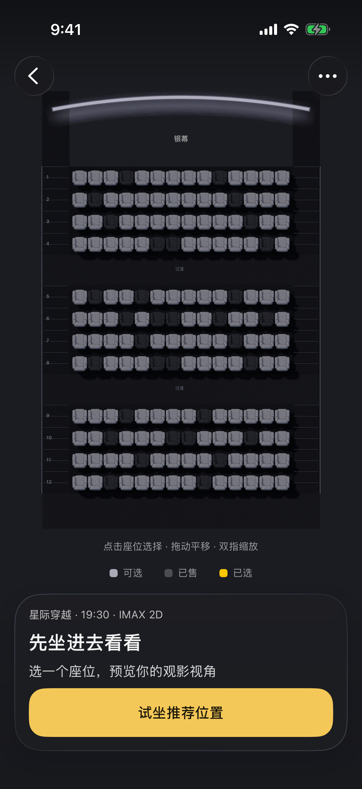
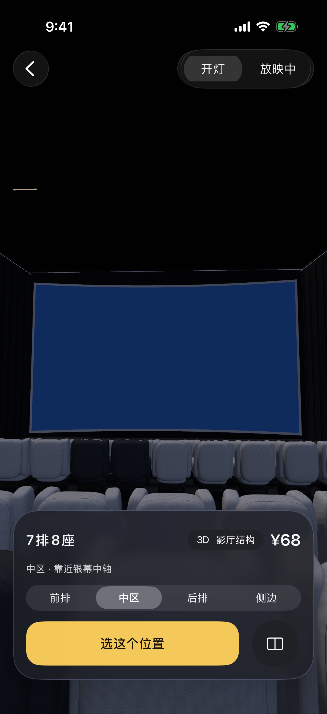
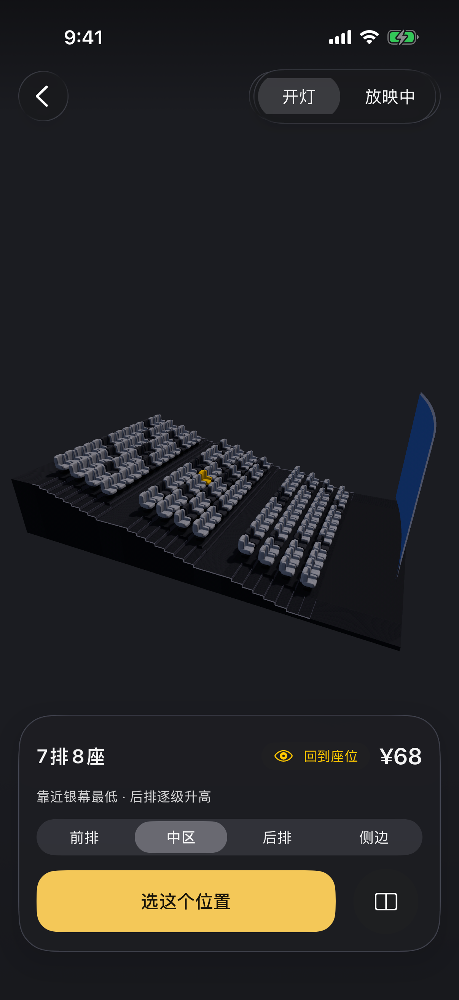

# 公开版本验证

验证日期：2026-11-12。

| 项目 | 结果 |
| --- | --- |
| 构建环境 | Xcode 27.2 |
| 测试设备 | iPhone 17 Pro 模拟器 |
| 系统 | iOS 26.5 |
| 模型测试 | 24 项通过 |
| UI 测试 | 2 项通过 |
| 失败 / 跳过 | 0 / 0 |
| Swift 源码 | 与本次发布前的最新 Demo 一致 |
| 可选影片资源 | 未包含；验证使用静态银幕回退 |

两个 UI 用例覆盖完整试坐 / 分区切换 / 开灯与放映 / 双座确认与预留，以及结构视图旋转缩放和返回实际座位。模型测试覆盖选座约束、计价、预留状态及影厅 / 视线几何。

测试截图：

| 总览 | 座位实景 | 结构视图 |
| --- | --- | --- |
|  |  |  |

[前排](images/front-view.png) · [后排](images/rear-view.png) · [保留成功](images/reservation.png)

重新运行：

```sh
cd iOSDemo
xcrun simctl list devices available
xcodebuild -project CinemaDemo.xcodeproj -scheme CinemaDemo \
  -destination 'platform=iOS Simulator,id=SIMULATOR_ID' \
  -derivedDataPath .build CODE_SIGNING_ALLOWED=NO \
  -only-testing:CinemaDemoTests \
  -only-testing:CinemaDemoUITests/CinemaFlowTests/testPreviewSwitchingSelectionAndReservation \
  -only-testing:CinemaDemoUITests/CinemaFlowTests/testStructurePreviewSwitchesSeatsAndReturnsToAccurateTopDownPicking \
  test
```

本次结果不代表真机性能、发热或所有屏幕尺寸已经验证。测试包、构建产物和开发机路径不进入公开仓库。
